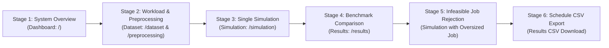

# Live Demonstration Script & Presentation Plan

**Project Title:** Resource Allocation and Scheduling Optimization for Enterprise Analytics: Heuristic, Metaheuristic, and Reinforcement Learning Methods  
**Target Duration:** 5–7 Minutes  
**Audience:** Project Examiners, Evaluators, and Viva Committee  

---

## 1. Pre-Demonstration Checklist

Complete these verification checks 10 minutes before the viva presentation:

- [ ] **Python Environment**: Confirm Python 3.10 is active and `uvicorn` is installed.
- [ ] **Node Environment**: Confirm Node.js 18+ and `npm` are available.
- [ ] **Backend Service Check**:
  - Run in terminal: `$env:PYTHONPATH="backend"; uvicorn app.main:app --host 127.0.0.1 --port 8000`
  - Verify `http://127.0.0.1:8000/api/status` returns `{"status":"ONLINE"}`.
- [ ] **Frontend Service Check**:
  - Run in terminal: `cd frontend; npm run preview -- --port 3000 --host 127.0.0.1` (or `npm run dev`)
  - Verify browser opens to `http://127.0.0.1:3000`.
- [ ] **Browser Preparation**: Open Chrome/Edge at 100% zoom with DevTools closed.
- [ ] **Database State**: Confirm `cluster_scheduler.db` exists and has write permissions.

---

## 2. Step-by-Step Live Demonstration Route (5–7 Minutes)

---

### Stage 1: System Status & Dashboard Navigation (1.0 Minute)
- **Action**: Navigate to `http://127.0.0.1:3000/`.
- **Visible Elements**:
  - Top navigation bar showing: **Dashboard**, **Dataset**, **Preprocessing**, **Workload**, **Simulation**, **Results**, **Experiments**, **Documentation**.
  - System Status Badge: **ONLINE** (green).
  - Metric Summary Cards: Default cluster physical capacity ($40$ CPU Cores, $256$ GB RAM, $8$ GPUs).
  - Algorithm Efficiency Comparison chart.
- **Presenter Spoken Explanation**:
  > *"Good morning committee members. Here is our live dashboard for Resource Allocation and Scheduling Optimization. The backend is running on FastAPI and connected via REST. As shown, our standardized cluster models 40 CPU cores, 256 gigabytes of RAM, and 8 dedicated GPUs. The system monitors cluster health and provides comparative metrics across 10 distinct scheduling algorithms."*

---

### Stage 2: Dataset Loading & 8-Step Preprocessing (1.0 Minute)
- **Action**:
  1. Click **Dataset** in the top navigation bar (`/dataset`).
  2. View the loaded Google Cluster Trace (10,000 tasks preview).
  3. Click **Preprocessing** in the navigation bar (`/preprocessing`).
  4. Select Missing Strategy: `Impute Mean`, Outlier Method: `IQR Method`, Scale Method: `MinMax Scaling`.
  5. Click **Run Preprocessing Pipeline**.
- **Visible Elements**:
  - Summary badges showing 0 remaining missing values, 0 remaining duplicates.
  - Tabular sample of cleaned and normalized job vectors.
- **Presenter Spoken Explanation**:
  > *"To ensure scheduling decisions operate on clean, standardized inputs, we implemented an automated 8-step preprocessing pipeline. Real-world trace data from Google clusters is validated, missing values are imputed, extreme outliers are clipped using interquartile range filtering, and multi-resource features are normalized into bounded ranges."*

---

### Stage 3: Discrete-Event Simulation & Interactive Gantt Timeline (1.5 Minutes)
- **Action**:
  1. Click **Simulation** in the navigation bar (`/simulation`).
  2. Select Algorithm: **PSO** (or **Q-Learning**).
  3. Select Scenario: **MEDIUM**.
  4. Number of Simulation Jobs: Enter `25`.
  5. Click **Run Single Simulation**.
- **Visible Elements**:
  - Execution spinner rotates for $\sim 1.5$ seconds.
  - KPI Cards update with live results:
    - Makespan ($\sim 176\text{s}$)
    - Avg Waiting Time ($\sim 8.9\text{s}$)
    - Overall Utilization ($\sim 44\%$)
    - SLA Violations ($\sim 9.6\%$)
    - Total Cost ($\sim \$60$)
  - Status Bar displays: `Submitted: 25 | Completed: 25 | Permanently Rejected: 0 | Completion Rate: 100.0%`.
  - **Interactive Gantt Chart** renders below, showing job execution intervals mapped across Server Slots over continuous time.
- **Presenter Spoken Explanation**:
  > *"Now we execute a single discrete-event simulation run. When I click 'Run Single Simulation', the backend's DiscreteEventSimulator processes arrivals and completions using an event priority queue. You can see the KPI cards update immediately, and below is our interactive Gantt chart. Each block represents a job executing across its assigned server slot without violating CPU, memory, or GPU capacity constraints."*

---

### Stage 4: Multi-Algorithm Benchmark Comparison Matrix (1.5 Minutes)
- **Action**:
  1. Click **Results** in the navigation bar (`/results`).
  2. Click **Re-run Benchmark** (or view the pre-loaded 10-algorithm comparison).
- **Visible Elements**:
  - Gold Trophy Card highlighting the #1 Ranked Algorithm: **PSO** (Score: $\sim 72.06$).
  - Side-by-side bar charts displaying Resource Utilization (%) and SLA Violation Rate vs. Cost.
  - Complete algorithm ranking table: PSO (#1), GA (#2), SJF (#3), SA (#4), Priority (#5), EDF (#6), Greedy (#7), FCFS (#8), DQN (#9), Q-Learning (#10).
- **Presenter Spoken Explanation**:
  > *"On the Results page, we benchmark all 10 algorithms side-by-side against identical workload inputs. As shown, Particle Swarm Optimization and Genetic Algorithms achieve the highest composite efficiency scores. Notice that SJF performs very well under medium load because it clears short jobs quickly, whereas our reinforcement learning agents—which operate under a compact training budget of 25 to 30 episodes—achieved lower scores under summary state representations."*

---

### Stage 5: Permanently Infeasible Job Rejection & Audit Warning (1.0 Minute)
- **Action**:
  1. Return to **Simulation** (`/simulation`).
  2. Select Scenario: **OVERLOADED** (or submit an oversized test job).
  3. Click **Run Single Simulation**.
- **Visible Elements**:
  - The simulation completes cleanly without hanging or infinite loops.
  - Prominent **Rose/Red Warning Banner** appears:
    `Permanently Infeasible Jobs Rejected (Count)`
  - Table displays: Job ID, Job Type, Requested Demands (e.g., `48 Cores / 32768 MB`), Terminal Status: `REJECTED`, Reason: `Exceeds total cluster capacity (CPU, Memory, or GPU)`.
  - Feasible jobs execute normally and are recorded in the schedule table.
- **Presenter Spoken Explanation**:
  > *"A critical safety feature of our scheduler is handling permanently infeasible tasks. If a tenant submits a job requiring 48 cores on our 40-core cluster, standard schedulers can deadlock. Our engine intercepts the oversized task upfront, assigns it an explicit terminal status of REJECTED, logs the diagnostic reason, and permits all feasible jobs to complete normally."*

---

### Stage 6: Sequential Order Sequence & CSV Schedule Export (30 Seconds)
- **Action**:
  1. Navigate to **Results** (`/results`).
  2. Scroll to the **Optimal Job Execution Sequence Order** section.
  3. Highlight the visual workflow badges: `Order #1 (JOB-XX) -> Order #2 (JOB-YY)...`.
  4. Click the **Export Order CSV** button.
- **Visible Elements**:
  - Browser downloads `job_execution_order_PSO.csv`.
  - Open file preview: contains `Execution_Order, Job_ID, Job_Type, Server, Arrival, Start, Finish, CPU, RAM, GPU, SLA_Status, Cost`.
- **Presenter Spoken Explanation**:
  > *"Finally, enterprise cluster administrators require deterministic dispatch sequences. Our system computes the exact chronological execution order—identifying which job runs 1st, 2nd, and 3rd—and provides a one-click CSV export for external workflow orchestration."*

---

## 3. Contingency & Backup Strategy

| Potential Issue | Immediate Fallback Action | Technical Contingency |
| :--- | :--- | :--- |
| **Backend port 8000 already in use** | Open PowerShell and kill lingering process: `Get-Process python \| Stop-Process -Force` | Relaunch with: `$env:PYTHONPATH="backend"; uvicorn app.main:app --port 8000` |
| **Vite preview port 3000 unavailable** | Launch development server on default fallback port: `cd frontend; npm run dev` | Access at `http://127.0.0.1:5173` |
| **Benchmark API timeout during live demo** | Explain that stochastic RL runs take $\sim 8\text{s}$; open pre-calculated view on `/results`. | Point to [`standardized_benchmark_results.json`](file:///c:/Users/BHARGAV709/Downloads/Major%20Project%20(1)/Major%20Project/standardized_benchmark_results.json) as the verified baseline. |
| **Browser cache or visual glitch** | Press `Ctrl + Shift + R` (Hard Reload) in Chrome/Edge. | All state is stateless or persisted in SQLite. |

---

## 4. Post-Demonstration Cleanup Instructions

When the live presentation concludes, restore the workspace to normal state:
1. Stop backend worker: Press `Ctrl + C` in backend PowerShell terminal.
2. Stop frontend preview: Press `Ctrl + C` in frontend terminal.
3. If temporary demonstration rows were added to SQLite, they can remain or be reset by deleting `cluster_scheduler.db` (it auto-recreates on next boot).

