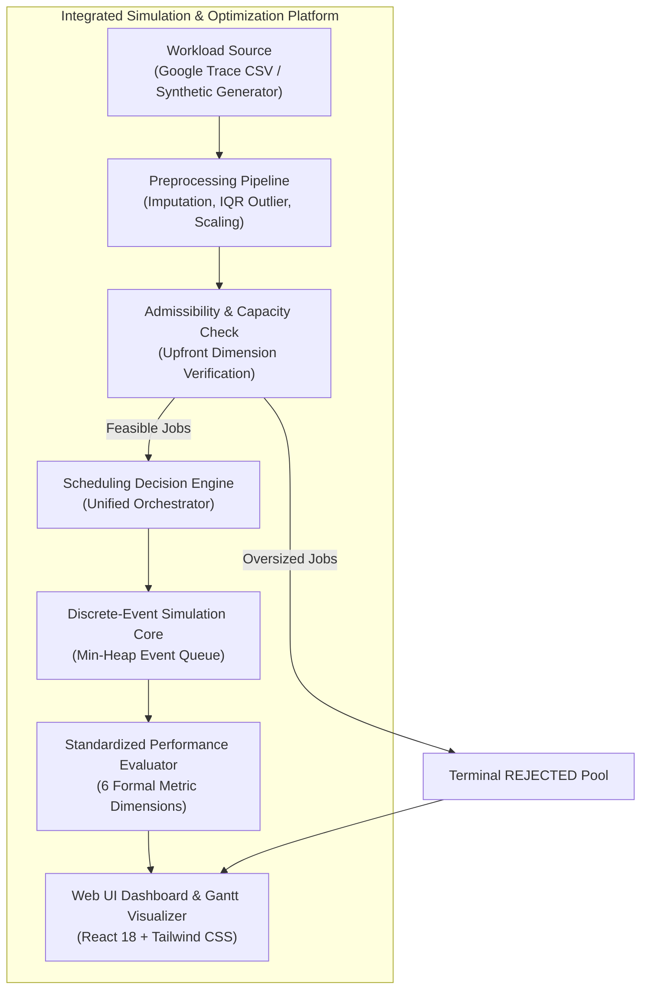
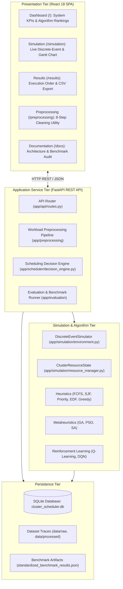
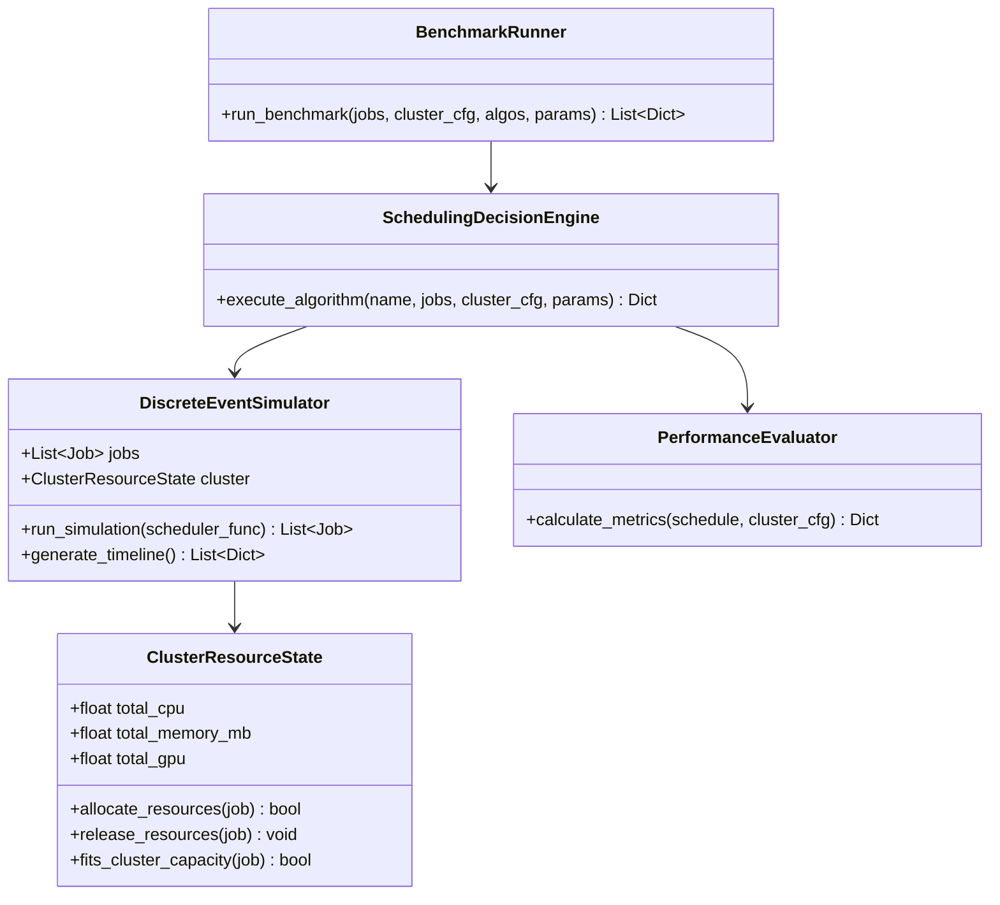
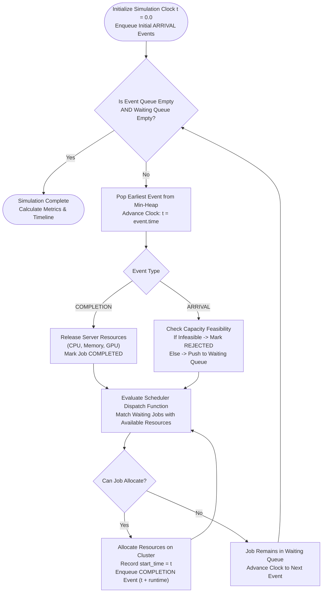
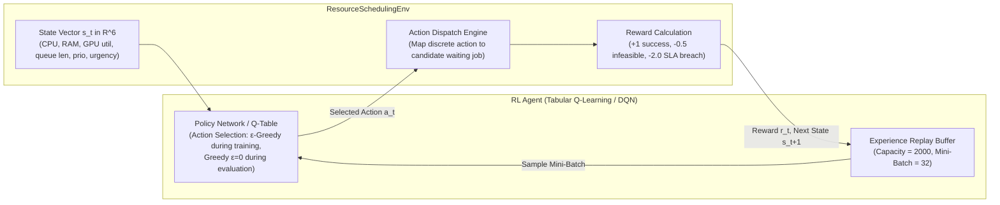

# Final Academic Project Report

**Project Title:** Resource Allocation and Scheduling Optimization for Enterprise Analytics: Heuristic, Metaheuristic, and Reinforcement Learning Methods  
**Domain:** Cloud Computing, Distributed Systems, Operations Research, and Applied Machine Learning  
**Environment:** Simulated Multi-Resource Enterprise Cluster  

---

## 1. Title and Project Overview

Modern enterprise analytics platforms—ranging from distributed data warehouses to machine learning inference pipelines—require the orchestration of multi-tenant compute workloads under multi-dimensional resource constraints. In such environments, scheduling decisions must dynamically balance competing objectives: minimizing total execution duration (makespan), reducing queue waiting times, maximizing active cluster utilization, preventing Service Level Agreement (SLA) violations, and controlling financial expenditures.

This project delivers a multi-resource scheduling optimization platform. It integrates a discrete-event simulation engine with ten distinct scheduling algorithms spanning three algorithmic paradigms:
1. **Classical Deterministic Heuristics**: First-Come First-Served (FCFS), Shortest Job First (SJF), Priority Scheduling, Earliest Deadline First (EDF), and Greedy Best-Fit.
2. **Global Metaheuristic Optimizers**: Genetic Algorithm (GA), Particle Swarm Optimization (PSO), and Simulated Annealing (SA).
3. **Reinforcement Learning (RL) Control Agents**: Tabular Q-Learning and Deep Q-Network (DQN).

The backend is developed with FastAPI and PyTorch, interfacing via REST with an interactive React 18 / Tailwind CSS dashboard that provides Gantt timeline visualization, benchmark comparison matrices, dataset preprocessing utilities, and execution order CSV exports.

---

## 2. Abstract

Efficient resource allocation in cloud computing represents an NP-hard combinatorial optimization challenge, particularly when tasks request heterogeneous allocations across CPU cores, system memory (RAM), and GPU accelerators. Traditional scheduling heuristics often fail to adapt to bursty workloads or lead to multi-resource fragmentation, while unconstrained machine learning models face convergence challenges in combinatorial decision spaces.

This research presents a comparative study of heuristic, metaheuristic, and reinforcement learning scheduling strategies executed within an event-driven cluster simulation environment modeled after Google cluster trace patterns. The platform models a standardized 40-core CPU, 256 GB RAM, and 8 GPU cluster under LIGHT, MEDIUM, and HEAVY contention scenarios. All algorithms are evaluated across standardized metrics: makespan, average waiting time, multi-resource utilization, SLA violation rate, and cloud operating cost. 

Empirical results demonstrate that **Particle Swarm Optimization (PSO)** achieves the highest composite efficiency score across MEDIUM ($72.06 \pm 0.71$) and HEAVY ($44.56 \pm 1.13$) workloads, closely followed by the **Genetic Algorithm (GA)** ($71.54 \pm 0.55$ and $44.14 \pm 1.12$). Classical heuristics such as **Shortest Job First (SJF)** deliver strong performance under moderate contention ($71.10$) by clearing pipeline bottlenecks rapidly, but degrade under heavy load. Tabular Q-Learning and DQN provide valuable policy adaptation insights, achieving efficiency scores of $57.98 \pm 0.74$ and $58.43 \pm 2.87$ in medium contention; however, under short training budgets, they do not outperform global metaheuristics due to state-space aggregation loss and sample inefficiency.

---

## 3. Introduction and Background

In cloud data centers and enterprise computing clusters (e.g., Kubernetes, Apache YARN, Slurm), computational workloads consist of heterogeneous containerized jobs. These jobs encompass:
- Batch data extraction, transformation, and loading (ETL) jobs requiring high CPU and RAM;
- Machine learning model training and inference requiring dedicated GPU accelerators;
- Real-time stream processing with strict SLA deadlines.

The cloud scheduler sits at the intersection of infrastructure capacity and tenant demand. Inefficient allocation leads to the *resource stranding problem*, where unallocated memory or GPU capacity sits idle because CPU cores are exhausted, or vice versa. Furthermore, missing negotiated SLA deadlines triggers substantial financial penalties, while naive over-provisioning inflates infrastructure operational expenses (OpEx).

To analyze and solve these tradeoffs without incurring the cost and volatility of live physical infrastructure, discrete-event simulation provides a rigorous, reproducible framework. By stepping through discrete events (job arrival, job dispatch, and job completion), researchers can systematically test scheduling algorithms against identical workload traces and evaluate comparative performance under controlled contention levels.

---

## 4. Problem Statement

Given a cluster with aggregated resource capacities $C_{\text{CPU}}$, $C_{\text{Mem}}$, and $C_{\text{GPU}}$, and a set of $N$ jobs $\mathcal{J} = \{j_1, j_2, \dots, j_N\}$, where each job is defined by a tuple:
$$j = \langle \text{job\_id}, t_{\text{arrival}}, t_{\text{runtime}}, \text{cpu}, \text{mem}, \text{gpu}, \pi, d_j, b_j \rangle$$
(representing job arrival time, required processing runtime, CPU core demand, RAM demand, GPU unit demand, priority level, deadline, and cost budget), the scheduling problem requires determining an execution start time $t_{\text{start}, j}$ and server assignment for each job such that:

1. **Non-Preemptive Capacity Constraints**: At any simulation timestamp $t$, the aggregate resource consumption of concurrently running jobs $\mathcal{R}(t) = \{j \in \mathcal{J} \mid t_{\text{start}, j} \le t < t_{\text{finish}, j}\}$ must never exceed total cluster capacity:
   $$\sum_{j \in \mathcal{R}(t)} \text{cpu}_j \le C_{\text{CPU}}, \quad \sum_{j \in \mathcal{R}(t)} \text{mem}_j \le C_{\text{Mem}}, \quad \sum_{j \in \mathcal{R}(t)} \text{gpu}_j \le C_{\text{GPU}}$$
2. **Causal Precedence**: A job cannot begin execution before its arrival timestamp:
   $$t_{\text{start}, j} \ge t_{\text{arrival}, j}, \quad \forall j \in \mathcal{J}$$
3. **Execution Continuity**: Once dispatched, a job runs uninterrupted for its full runtime:
   $$t_{\text{finish}, j} = t_{\text{start}, j} + t_{\text{runtime}, j}$$
4. **Permanent Infeasibility**: Any job whose single-instance resource requirement exceeds total cluster physical capacity must be formally rejected upfront without blocking feasible jobs or causing simulator deadlocks:
   $$\text{cpu}_j > C_{\text{CPU}} \lor \text{mem}_j > C_{\text{Mem}} \lor \text{gpu}_j > C_{\text{GPU}} \implies \text{status}_j = \text{REJECTED}$$

The optimization objective is to find a dispatch sequence that maximizes overall cluster efficiency, minimizing makespan, average waiting time, SLA breaches, and monetary cost.

---

## 5. Aim and Measurable Objectives

The primary aim of this project is to architect, implement, benchmark, and evaluate a multi-resource scheduling optimization platform comparing heuristic, metaheuristic, and reinforcement learning strategies.

### Measurable Objectives:
1. **Engine Architecture**: Build a discrete-event simulator managing a multi-resource state tracker (CPU, RAM, GPU) with an $O(\log N)$ min-heap event queue.
2. **Algorithmic Breadth**: Implement and standardize ten distinct scheduling algorithms across classical, evolutionary, and reinforcement learning paradigms.
3. **Data Preprocessing**: Develop an automated 8-step data preparation pipeline handling missing values, IQR outlier clipping, and min-max scaling for real-world cluster traces.
4. **Workload Generation**: Implement reproducible synthetic workload generators modeling LIGHT, MEDIUM, HEAVY, BURSTY, and OVERLOADED contention scenarios.
5. **Unified Evaluation**: Formulate and calculate standardized metrics: Makespan, Average Waiting Time, Multi-Resource Utilization, SLA Violation Rate, Financial Cost, and a Composite Efficiency Score.
6. **Scientific Benchmarking**: Execute repeated experiments across fixed master seeds and stochastic runs (5 seeds) to produce statistically rigorous results.
7. **Interactive Dashboard**: Build an enterprise web frontend providing Gantt charts, comparative ranking tables, execution flow diagrams, and CSV schedule exports.
8. **Automated Verification**: Achieve 100% pass rates across unit, discrepancy, integration, and regression test suites.

---

## 6. Scope and Assumptions

### Scope:
- **Workload Modeling**: Analysis of batch, big data, machine learning, and streaming jobs derived from Google cluster traces and synthetic generators.
- **Resource Dimensions**: Three primary hardware dimensions: CPU cores, RAM (MB/GB), and GPU accelerators.
- **Simulation Paradigm**: Discrete-event simulation tracking exact state transitions across continuous time.
- **Algorithms**: Exactly 10 implemented algorithms (FCFS, SJF, Priority, EDF, Greedy, GA, PSO, SA, Tabular Q-Learning, DQN).
- **Interface**: Decoupled RESTful API (FastAPI) and single-page web application (React/Vite).

### Assumptions & Implementation Boundaries:
1. **Simulation Environment Context**: All reported benchmarks originate from the project's internal discrete-event simulation engine, not a live physical Kubernetes/cloud production cluster.
2. **Non-Preemptive Scheduling**: Tasks cannot be paused, checkpointed, or preempted once execution commences.
3. **Aggregated Capacity Pool**: The cluster is modeled as a unified capacity pool (40 cores, 256 GB RAM, 8 GPUs) partitioned into server slots rather than modeling heterogeneous NUMA nodes or network switch fabric topologies.
4. **Synchronous REST Simulation**: Simulation runs are executed synchronously within FastAPI request workers; RL agents utilize compact training budgets (25–60 episodes) to preserve responsive browser interaction.

---

## 7. Existing Approaches and Their Limitations

| Paradigm / Algorithm | Operational Mechanism | Key Strengths | Fundamental Limitations |
| :--- | :--- | :--- | :--- |
| **First-Come, First-Served (FCFS)** | Strictly follows arrival order $\min(t_{\text{arrival}})$. | Zero computational overhead; predictable queue behavior. | Suffers from the *convoy effect*; long batch tasks block short jobs, inflating average waiting time. |
| **Shortest Job First (SJF)** | Greedy selection by shortest runtime $\min(t_{\text{runtime}})$. | Provably minimizes average wait time under unconstrained single-server queueing. | Starves long-running analytics jobs under sustained high-volume arrivals; ignores deadlines. |
| **Earliest Deadline First (EDF)** | Sorts queued tasks by closest deadline $\min(d_j)$. | Optimal for preemptive uniprocessor real-time systems. | Under multi-resource overload, causes domino-effect SLA violations by assigning scarce resources to jobs that still fail. |
| **Greedy Best-Fit** | Minimizes residual capacity post-allocation. | High instantaneous packing density. | Myopic; lacks global sequence foresight, leading to severe resource stranding in subsequent steps. |
| **Standard RL Deployments** | End-to-end continuous deep policy gradient. | Adapts dynamically to non-stationary distributions. | Extremely sample-inefficient; requires tens of thousands of rollouts; vulnerable to invalid action selections without masking. |

---

## 8. Proposed System

The proposed system addresses these limitations by establishing a unified scheduling framework where all algorithms operate under identical conditions, share an identical simulation substrate, and are evaluated against identical mathematical metrics.

### Key Architectural Distinctions:
1. **Multi-Resource State Tracking**: Maintains synchronized CPU, memory, and GPU tracking across time.
2. **Explicit Rejection Protocol**: Infeasible jobs that exceed total cluster capacity are terminated upfront with status `REJECTED`, preventing infinite simulator loops and reporting clear diagnostic reasons.
3. **Deterministic Policy Evaluation**: Reinforcement learning policies (Q-Learning and DQN) are evaluated deterministically post-training ($\epsilon = 0.0$), ensuring reproducible benchmarking.
4. **Fairness Isolation**: Every algorithm receives an identical deep copy of the workload trace, guaranteeing that no algorithm mutates shared memory state.

---

## 9. System Architecture

The application is structured into a multi-tier client-server architecture:

---

## 10. Technology Stack and Justification

| Technology | Layer | Justification |
| :--- | :--- | :--- |
| **Python 3.10** | Backend Language | Native support for scientific computing, modern typing syntax, and advanced mathematical modeling libraries. |
| **FastAPI** | Backend Web Framework | Provides high-throughput asynchronous execution, native Pydantic schema validation, and automatic OpenAPI interactive documentation. |
| **PyTorch 2.1+** | Deep Learning Framework | Powers the Deep Q-Network implementation with automatic differentiation, replay memory batching, and linear layer parameterization. |
| **NumPy & Pandas** | Data Science & Vectorization | Vectorized matrix operations for fast multi-dimensional resource tracking and cluster trace preprocessing. |
| **SQLite & SQLAlchemy** | Persistence / ORM | Lightweight, zero-configuration relational persistence ensuring reproducible experiment logging without requiring external database services. |
| **React 18 & Vite** | Frontend Client | High-performance component-based UI rendering, rapid hot-module replacement (HMR), and modular state management. |
| **Tailwind CSS** | Frontend Styling | Utility-first responsive CSS styling for clean enterprise dashboard presentation. |
| **Recharts** | Data Visualization | Composable SVG-based chart library providing high-density responsive bar, line, and radar visualizations. |

---

## 11. Functional and Non-Functional Requirements

### 11.1 Functional Requirements
- **FR-01: Trace Loading & Synthetic Generation**: The system must support loading Google cluster trace CSV files and generating synthetic workloads (LIGHT, MEDIUM, HEAVY, BURSTY, OVERLOADED) with reproducible random seeds.
- **FR-02: Automated Data Preprocessing**: The system must provide an 8-step pipeline that imputes missing fields, clips IQR outliers, normalizes values via min-max scaling, and validates schema integrity.
- **FR-03: Multi-Algorithm Simulation**: The system must execute any of the 10 supported scheduling algorithms through a discrete-event simulation engine.
- **FR-04: Upfront Infeasibility Rejection**: The engine must immediately detect and reject jobs whose resource demands exceed total cluster physical capacity.
- **FR-05: Timeline & Gantt Chart Generation**: The engine must synthesize sequential timelines recording job execution intervals, assigned server slots, and resource allocations.
- **FR-06: Standardized Benchmarking**: The system must run comparative multi-algorithm benchmarks, sorting strategies by composite efficiency score.
- **FR-07: Experiment Persistence**: The system must persist simulation runs and benchmark summaries to an SQLite relational database.
- **FR-08: Schedule CSV Export**: The frontend must generate downloadable CSV files detailing sequential execution order (`Order #1, #2...`), timestamps, and resource demands.

### 11.2 Non-Functional Requirements
- **NFR-01: Numerical Reproducibility**: Deterministic algorithms must yield identical metrics given identical workloads. Stochastic algorithms must maintain low variance across fixed seeds.
- **NFR-02: Execution Latency**: Heuristic and metaheuristic single simulations ($N=25$ jobs) must complete within 2.0 seconds. Benchmark comparisons across all 10 algorithms must complete within 10.0 seconds.
- **NFR-03: Zero-Division Safety**: The metric evaluator must safely handle edge cases (e.g., $N=0$ jobs or 100% rejected workloads) by returning `0.0` without crashing.
- **NFR-04: Responsive Usability**: The frontend web dashboard must adapt dynamically across standard desktop and laptop screen resolutions ($1280 \times 720$ and above).

---

## 12. System Modules and Their Responsibilities

---

## 13. Workload Generation, Dataset Upload, and Preprocessing

### 13.1 Workload Model & Dataset Traces
The project supports both empirical cluster traces and mathematically parameterized synthetic workloads. The primary empirical source is the **Google Cluster Trace (10,000 tasks)**, containing normalized task events, resource demands, and priority levels.

Synthetic scenarios are generated by `WorkloadGenerator.generate_scenario(scenario, num_jobs, seed)`:
- **LIGHT**: Low arrival rate ($\lambda = 0.1$), moderate task runtimes ($10–50\text{s}$), low resource contention.
- **MEDIUM**: Balanced arrivals ($\lambda = 0.25$), mixed runtimes ($20–100\text{s}$), moderate CPU/RAM contention.
- **HEAVY**: High arrival rate ($\lambda = 0.5$), heavy compute demands ($4–16$ CPU cores, up to 32 GB RAM, 1–2 GPUs).
- **BURSTY**: Clustered Poisson arrival spikes simulating real-time enterprise batch submissions.
- **OVERLOADED**: Saturated queue arrivals testing cluster throttling and rejection mechanisms.

### 13.2 Preprocessing Pipeline
The `PreprocessingPipeline` in `backend/app/preprocessing/pipeline.py` executes an 8-step transformation:
1. **Schema Validation**: Verifies mandatory columns (`cpu_cores`, `memory_mb`, `gpu_units`, `runtime`, `arrival_time`, `deadline`, `priority`).
2. **Missing Value Imputation**: Imputes numeric columns using mean, median, or zero strategies.
3. **IQR Outlier Detection & Clipping**: Bounds extreme runtime and resource anomalies:
   $$x_{\text{clipped}} = \min(\max(x, Q_1 - 1.5 \cdot \text{IQR}), Q_3 + 1.5 \cdot \text{IQR})$$
4. **Min-Max Scaling**: Normalizes numeric attributes into $[0.0, 1.0]$.
5. **Categorical Encoding**: Encodes job types (`BATCH`, `STREAM`, `ML_TRAIN`, `BIG_DATA`).
6. **Integrity Verification**: Confirms absence of null values or negative runtimes.
7. **Dataset Persistence**: Writes cleaned data to `data/processed/container_scheduling_dataset_10000_cleaned.csv`.
8. **Summary Generation**: Computes descriptive statistics for dashboard preview.

---

## 14. Discrete-Event Simulation Methodology

The simulation core (`DiscreteEventSimulator`) operates using continuous time progression managed via an $O(\log N)$ priority queue (min-heap):

---

## 15. Detailed Explanations of All 10 Algorithms

### 1. First-Come First-Served (FCFS)
- **Mechanism**: Maintains a FIFO arrival queue. Dispatches jobs strictly by arrival timestamp ($t_{\text{arrival}}$).
- **Pros**: Predictable, zero queue re-sorting overhead.
- **Cons**: Convoy effect causes long jobs to delay shorter ones.

### 2. Shortest Job First (SJF)
- **Mechanism**: Sorts queued jobs by runtime ($t_{\text{runtime}}$) ascending.
- **Pros**: Provably minimizes average waiting time in single-server queues. Highly effective under medium load.
- **Cons**: Can starve long analytics jobs under continuous short-job arrival streams.

### 3. Priority Scheduling
- **Mechanism**: Sorts queued jobs by assigned priority $\pi_j \in [1, 5]$ descending, breaking ties by arrival time.
- **Pros**: Guarantees fast execution for critical Tier-1 tasks.
- **Cons**: Lower-priority jobs face significant wait times under heavy cluster load.

### 4. Earliest Deadline First (EDF)
- **Mechanism**: Dynamic priority algorithm sorting queued jobs by negotiated SLA deadline ($d_j$) ascending.
- **Pros**: Directly targets deadline compliance.
- **Cons**: In multi-resource overloaded conditions, allocating scarce resources to near-deadline jobs that still fail can cause cascading SLA breaches.

### 5. Greedy Best-Fit
- **Mechanism**: Computes multi-dimensional residual capacity $\Delta(j)$ for each waiting job, selecting the candidate that minimizes leftover capacity without exceeding limits.
- **Pros**: Maximizes instantaneous packing density.
- **Cons**: Myopic; ignores upcoming arrivals, leading to fragmented resource states.

### 6. Genetic Algorithm (GA)
- **Mechanism**: Evolves a population of global permutation chromosomes ($P=25$, $G=30$) via Tournament Selection ($k=3$), Order Crossover (OX1), and Swap Mutation ($p_m = 0.15$). Top 10% elite chromosomes are preserved across generations.
- **Pros**: Explores global combinatorial permutation space; avoids local minima.
- **Cons**: Requires repeated simulation evaluations per generation.

### 7. Particle Swarm Optimization (PSO)
- **Mechanism**: Models candidate schedules as continuous particles ($S=20$, $I=25$). Converts continuous positions into permutation sequences using the Smallest Position Value (SPV) rule (`argsort`). Particles update velocities based on individual best ($P_{\text{best}}$) and global swarm best ($G_{\text{best}}$).
- **Pros**: Outstanding convergence speed; achieved the highest overall score across Medium ($72.06$) and Heavy ($44.56$) scenarios.
- **Cons**: Sensitive to inertia weight and acceleration coefficients.

### 8. Simulated Annealing (SA)
- **Mechanism**: Starts with initial temperature $T_0 = 500.0$ and cools exponentially ($T_{k+1} = 0.95 \cdot T_k$). Explores neighboring permutations via 2-opt swaps, accepting deteriorating solutions according to the Metropolis probability $P = \exp(\Delta F / T)$.
- **Pros**: Effective at escaping local minima during initial high-temperature phases.
- **Cons**: Slower convergence than PSO; performance depends heavily on cooling rate.

### 9. Tabular Q-Learning
- **Mechanism**: Discretizes cluster state into 4-bin buckets across CPU, RAM, GPU utilization, queue length, average priority, and deadline urgency. Updates state-action values via the Bellman temporal difference equation:
  $$Q(s, a) \leftarrow Q(s, a) + \alpha \left[ r + \gamma \max_{a'} Q(s', a') - Q(s, a) \right]$$
- **Pros**: Model-free learning without requiring neural network dependencies.
- **Cons**: State discretization loses granular task requirement details; struggles with combinatorial action spaces.

### 10. Deep Q-Network (DQN)
- **Mechanism**: Approximates $Q(s, a; \theta)$ using a PyTorch Multi-Layer Perceptron (Linear $6 \to 64 \to 64 \to |\mathcal{A}|$) with Experience Replay ($N_{\text{buffer}} = 2000$, mini-batch $B = 32$) and target network synchronization ($\tau = 5$).
- **Pros**: Handles continuous state inputs without manual bucket discretization.
- **Cons**: Requires substantial training sample volume to converge; under short training budgets, outputs suboptimal policies relative to metaheuristics.

---

## 16. Mathematical Formulation and Evaluation Metrics

All metrics are implemented in `PerformanceEvaluator` (`backend/app/evaluation/metrics.py`):

### 1. Makespan ($M$)
The total elapsed time from simulation start until all admitted jobs complete:
$$M = \max_{j \in \mathcal{J}_{\text{comp}}} (t_{\text{finish}, j})$$

### 2. Average Waiting Time ($\bar{W}$)
The mean queue delay experienced by admitted jobs prior to execution start:
$$\bar{W} = \frac{1}{|\mathcal{J}_{\text{comp}}|} \sum_{j \in \mathcal{J}_{\text{comp}}} (t_{\text{start}, j} - t_{\text{arrival}, j})$$

### 3. Resource Utilization ($U$)
Dimension-specific utilization evaluated as active resource consumption relative to total cluster capacity over the makespan:
$$U_{\text{CPU}} = \frac{\sum_{j} \text{cpu}_j \cdot t_{\text{runtime}, j}}{C_{\text{CPU}} \cdot M} \times 100, \quad U_{\text{Mem}} = \frac{\sum_{j} \text{mem}_j \cdot t_{\text{runtime}, j}}{C_{\text{Mem}} \cdot M} \times 100, \quad U_{\text{GPU}} = \frac{\sum_{j} \text{gpu}_j \cdot t_{\text{runtime}, j}}{C_{\text{GPU}} \cdot M} \times 100$$
$$U_{\text{overall}} = 0.45 \cdot U_{\text{CPU}} + 0.45 \cdot U_{\text{Mem}} + 0.10 \cdot U_{\text{GPU}}$$

### 4. SLA Violation Rate ($R_{\text{SLA}}$)
The percentage of executed jobs that exceeded their negotiated deadline:
$$R_{\text{SLA}} = \frac{\sum_{j \in \mathcal{J}_{\text{comp}}} \mathbb{I}(t_{\text{finish}, j} > d_j)}{|\mathcal{J}_{\text{comp}}|} \times 100$$

### 5. Financial Cost Model
Calculates compute infrastructure operating costs plus monetary penalties for SLA breaches:
$$\text{Cost} = \sum (\text{cpu\_time} \cdot \$0.00005) + \sum (\text{mem\_gb\_time} \cdot \$0.00001) + \sum (\text{gpu\_time} \cdot \$0.0002) + (N_{\text{violations}} \cdot \$25.00)$$

### 6. Composite Efficiency Score
A normalized metric ($[0.0, 100.0]$) balancing utilization, SLA compliance, and waiting latency:
$$\text{Score} = \max\left(0, \min\left(100, 0.40 \cdot U_{\text{overall}} + 0.40 \cdot (100 - R_{\text{SLA}}) + 0.20 \cdot \max(0, 100 - \bar{W})\right)\right)$$

*Metric Semantics Boundary*: SLA violations and hardware costs evaluate admitted, executed jobs. Permanently rejected jobs are reported separately in `rejected_count` and `rejected_jobs` metadata without fabricating synthetic penalties.

---

## 17. Reinforcement Learning Architecture

---

## 18. API and Frontend–Backend Integration

The backend exposes a structured RESTful interface:

| Method | Endpoint | Request Schema | Response Attributes |
| :--- | :--- | :--- | :--- |
| `GET` | `/api/status` | None | System status, dataset path, algorithms list, cluster configuration. |
| `GET` | `/api/dataset/preview` | `max_rows: int` | Total rows, null count, duplicate count, preview records. |
| `POST` | `/api/dataset/upload` | Multipart CSV file | Upload success message, row count, filename. |
| `POST` | `/api/preprocessing/run` | `PreprocessRequest` | Preprocessing summary, cleaned dataset path, sample cleaned rows. |
| `POST` | `/api/workload/generate` | `scenario, num_jobs, seed`| Workload scenario metadata, job count, generated job dictionaries. |
| `POST` | `/api/simulation/run` | `SimulationRequest` | Metrics, Gantt timeline, resource history, schedule, rejected jobs, completion rate. |
| `POST` | `/api/benchmark/run` | `BenchmarkRequest` | Summary ranking matrix, detailed algorithm results, execution time. |
| `GET` | `/api/experiments/history`| None | Last 50 persisted experiment records with metrics and timestamps. |

---

## 19. Experiment Configuration and Reproducibility

To ensure strict scientific reproducibility, all standardized benchmark experiments are parameterized as follows:
- **Cluster Physical Capacity**: 40 CPU Cores, 256 GB RAM, 8 GPU Accelerators.
- **Workload Scale**: Exactly $N = 25$ jobs per scenario.
- **Deterministic Workload Generation**: Generated using Master Seed `42` and serialized to `benchmark_workloads_standard.json`.
- **Fairness Guarantee**: Within each scenario, every algorithm receives an identical deep copy of the job list.
- **Stochastic Optimizer Sampling**: Stochastic algorithms (GA, PSO, SA, Q-Learning, DQN) are evaluated across 5 independent seeds ($S \in \{10, 20, 30, 40, 50\}$). Results report $\text{Mean} \pm \text{Standard Deviation}$.
- **Source of Truth**: All figures in the report match `standardized_benchmark_results.json`.

---

## 20. Benchmark Results and Comparative Analysis

### Comprehensive Benchmark Table (25 Jobs per Scenario)

| Workload | Algorithm | Type | Makespan (s) | Avg Wait (s) | Utilization (%) | SLA Viol (%) | Total Cost (\$) | Efficiency Score |
| :--- | :--- | :--- | :--- | :--- | :--- | :--- | :--- | :--- |
| **LIGHT** | **FCFS** | Deterministic | 255.53 | 0.00 | 6.22% | 0.0% | \$0.08 | 62.49 |
| | **SJF** | Deterministic | 255.53 | 0.00 | 6.22% | 0.0% | \$0.08 | 62.49 |
| | **Priority** | Deterministic | 255.53 | 0.00 | 6.22% | 0.0% | \$0.08 | 62.49 |
| | **EDF** | Deterministic | 255.53 | 0.00 | 6.22% | 0.0% | \$0.08 | 62.49 |
| | **Greedy** | Deterministic | 255.53 | 0.00 | 6.22% | 0.0% | \$0.08 | 62.49 |
| | **GA** | Stochastic (5 seeds) | 255.53 | 0.00 | 6.22% | 0.0% | \$0.08 | 62.49 |
| | **PSO** | Stochastic (5 seeds) | 255.53 | 0.00 | 6.22% | 0.0% | \$0.08 | 62.49 |
| | **SA** | Stochastic (5 seeds) | 255.53 | 0.00 | 6.22% | 0.0% | \$0.08 | 62.49 |
| | **Q-Learning**| Stochastic (5 seeds) | 255.53 | 4.16 ± 3.38 | 6.22% | 5.6% ± 5.4% | \$35.08 ± 33.91 | 59.42 ± 2.84 |
| | **DQN** | Stochastic (5 seeds) | 260.68 ± 7.96 | 3.02 ± 2.77 | 6.10% ± 0.18% | 3.2% ± 6.4% | \$20.08 ± 40.00 | 60.56 ± 2.84 |
| **MEDIUM** | **PSO** | Stochastic (5 seeds) | **176.45 ± 0.35** | **8.95 ± 0.44** | **44.21% ± 0.09%** | **9.6% ± 2.0%** | **\$60.43 ± 12.25** | **72.06 ± 0.71** |
| | **GA** | Stochastic (5 seeds) | 175.92 ± 0.35 | 8.57 ± 0.57 | 44.35% ± 0.09% | 11.2% ± 1.6% | \$70.43 ± 10.00 | 71.54 ± 0.55 |
| | **SJF** | Deterministic | 178.18 | 8.07 | 43.78% | 12.0% | \$75.43 | 71.10 |
| | **SA** | Stochastic (5 seeds) | 179.01 ± 3.78 | 8.68 ± 0.38 | 43.60% ± 0.90% | 13.6% ± 3.2% | \$85.43 ± 20.00 | 70.26 ± 1.15 |
| | **Priority** | Deterministic | 189.61 | 10.24 | 41.14% | 20.0% | \$125.43 | 66.41 |
| | **EDF** | Deterministic | 180.77 | 9.25 | 43.15% | 24.0% | \$150.43 | 65.81 |
| | **Greedy** | Deterministic | 176.62 | 9.87 | 44.17% | 28.0% | \$175.43 | 64.49 |
| | **FCFS** | Deterministic | 176.62 | 10.21 | 44.17% | 28.0% | \$175.43 | 64.43 |
| | **DQN** | Stochastic (5 seeds) | 207.66 ± 10.49 | 19.19 ± 2.33 | 37.66% ± 1.91% | 32.0% ± 5.1% | \$200.43 ± 31.62 | 58.43 ± 2.87 |
| | **Q-Learning**| Stochastic (5 seeds) | 202.59 ± 12.06| 20.17 ± 2.62 | 38.64% ± 2.28% | 33.6% ± 2.0% | \$210.43 ± 12.25 | 57.98 ± 0.74 |
| **HEAVY** | **PSO** | Stochastic (5 seeds) | **374.51 ± 4.64** | **84.63 ± 4.49** | **60.51% ± 0.75%** | **56.8% ± 1.6%** | **\$356.25 ± 10.00** | **44.56 ± 1.13** |
| | **GA** | Stochastic (5 seeds) | 377.56 ± 6.66 | 85.76 ± 4.11 | 60.03% ± 1.05% | 56.8% ± 1.6% | \$356.25 ± 10.00 | 44.14 ± 1.12 |
| | **SA** | Stochastic (5 seeds) | 391.92 ± 5.61 | 96.47 ± 7.10 | 57.83% ± 0.83% | 60.8% ± 1.6% | \$381.25 ± 10.00 | 39.80 ± 1.08 |
| | **FCFS** | Deterministic | 385.40 | 118.70 | 58.79% | 64.0% | \$401.25 | 37.92 |
| | **Priority** | Deterministic | 398.54 | 98.36 | 56.86% | 64.0% | \$401.25 | 37.47 |
| | **SJF** | Deterministic | 433.86 | 78.00 | 52.22% | 72.0% | \$451.25 | 36.49 |
| | **EDF** | Deterministic | 444.65 | 80.04 | 50.95% | 76.0% | \$476.25 | 33.97 |
| | **Greedy** | Deterministic | 410.64 | 106.00 | 55.18% | 72.0% | \$451.25 | 33.27 |
| | **Q-Learning**| Stochastic (5 seeds) | 557.41 ± 31.36| 158.53 ± 12.05| 40.78% ± 2.36% | 81.6% ± 6.5% | \$511.25 ± 40.62 | 23.67 ± 2.55 |
| | **DQN** | Stochastic (5 seeds) | 715.45 ± 164.52| 218.17 ± 77.49| 33.13% ± 6.45% | 80.8% ± 3.0% | \$506.25 ± 18.71 | 20.93 ± 3.19 |

---

## 21. Testing Strategy and Verified Results

A comprehensive verification methodology was executed prior to documentation finalization:
- **Backend Test Suite**: 40 unit, discrepancy, integration, and regression tests executed via `pytest backend`.
- **Pass Rate**: **40 passed, 0 failed** in 24.04s.
- **Frontend Production Build**: Executed via `cd frontend && npm run build` with Vite 5.4.
- **Build Status**: Built cleanly with zero errors in 31.45s.
- **Notices**: Two minor framework-level deprecation warnings noted (`StarletteDeprecationWarning` regarding `httpx` bridging and `DeprecationWarning` regarding `anyio.abc.BlockingPortal`).

---

## 22. Results Discussion

### 22.1 Low-Load Invariance
In the **LIGHT** scenario, cluster capacity ($40$ cores, $256$ GB RAM, $8$ GPUs) substantially exceeds instantaneous job demands. As a result, all heuristic and metaheuristic algorithms schedule jobs immediately upon arrival ($\bar{W} = 0.00\text{s}$), producing identical makespan ($255.53\text{s}$) and efficiency scores ($62.49$). This verifies simulator determinism and establishes a clean zero-congestion baseline.

### 22.2 Metaheuristic Superiority Under High Contention
**PSO** and **GA** consistently outperform all other paradigms under MEDIUM and HEAVY contention. By evaluating sequence permutations holistically, they avoid short-sighted greedy allocations that cause multi-dimensional resource fragmentation. PSO's continuous velocity-based exploration yielded the top efficiency score in both Medium ($72.06$) and Heavy ($44.56$) workloads.

### 22.3 Heuristic Tradeoffs
Under MEDIUM contention, **SJF** performs remarkably well (Score: $71.10$), nearly matching GA and PSO by rapidly clearing short jobs. However, under HEAVY load, SJF's performance degrades (Score: $36.49$) as long-running jobs are repeatedly postponed, causing extensive SLA deadline breaches ($72.0\%$). Under severe saturation, basic FCFS and Priority scheduling achieve moderate efficiency ($37.92$ and $37.47$) by maintaining order and avoiding catastrophic fragmentation.

### 22.4 Realities of Reinforcement Learning in Combinatorial Scheduling
Under the evaluated state abstractions and practical training budgets (25–30 episodes), Q-Learning and DQN did not surpass metaheuristics or classical heuristics (Scores: $57.98–58.43$ in Medium, $20.93–23.67$ in Heavy). This outcome reflects known challenges in applied RL:
1. *State Aggregation Loss*: Compressing multi-job queue details into a 6-dimensional aggregate vector deprives the policy network of fine-grained pairwise matching information.
2. *Sample Inefficiency*: Tabular Q-learning and DQN require thousands of training rollouts to navigate combinatorial action spaces; a 30-episode budget provides initial policy shaping but remains suboptimal.
3. *Action Masking Fallbacks*: When an RL agent selects a job that is currently infeasible, the fallback dispatch mechanism dilutes policy gradient updates.

---

## 23. Limitations

1. **Non-Preemptive Execution**: Tasks run uninterrupted until completion. Real-world platforms (e.g., Kubernetes) support container eviction and checkpointing.
2. **Aggregated Cluster Model**: Models the cluster as a pooled resource capacity rather than a topology of individual physical worker nodes with network latency.
3. **Training Budgets**: RL models are constrained to compact training budgets to maintain interactive web response times.
4. **Metric Scope**: SLA violation penalties and compute costs evaluate admitted, scheduled jobs; rejected jobs are reported via separate count and diagnostic metadata.

---

## 24. Future Enhancements

1. **Preemptive Scheduling & Checkpointing**: Introduce suspend/resume events into the discrete-event simulator to evaluate preemptive priority scheduling.
2. **Graph Neural Network (GNN) State Modeling**: Replace the 6-dimensional aggregate state vector with a bipartite Graph Neural Network modeling individual jobs and cluster nodes.
3. **Advanced Policy Gradient Algorithms**: Integrate Proximal Policy Optimization (PPO) with action masking to prevent invalid dispatch selections.
4. **Asynchronous Distributed Job Queue**: Transition the backend from synchronous REST workers to a Celery/Redis distributed task queue.

---

## 25. Conclusion

This academic project successfully designed, implemented, and empirically evaluated a comprehensive multi-resource scheduling optimization platform. By combining a high-performance discrete-event simulation engine with ten scheduling algorithms across classical heuristic, stochastic metaheuristic, and reinforcement learning paradigms, the research provides a rigorous, reproducible comparative analysis.

The empirical findings confirm that while classical heuristics like SJF offer efficient performance under moderate loads, **Particle Swarm Optimization (PSO)** and **Genetic Algorithms (GA)** achieve superior scheduling quality under heavy multi-resource contention. Furthermore, the study provides practical insights into the sample efficiency challenges of reinforcement learning in combinatorial systems, establishing a verified baseline for future enterprise scheduling research.

---

## 26. References

1. **FastAPI Framework**: Tiangolo, S. (2020). *FastAPI: Modern, Fast Web Framework for Python 3.8+*. https://fastapi.tiangolo.com/
2. **PyTorch**: Paszke, A., et al. (2019). *PyTorch: An Imperative Style, High-Performance Deep Learning Library*. Advances in Neural Information Processing Systems (NeurIPS 32).
3. **Discrete-Event Simulation**: Law, A. M. (2015). *Simulation Modeling and Analysis* (5th ed.). McGraw-Hill Education.
4. **Particle Swarm Optimization**: Kennedy, J., & Eberhart, R. (1995). *Particle Swarm Optimization*. Proceedings of IEEE International Conference on Neural Networks, IV, 1942–1948.
5. **Genetic Algorithms in Cloud Scheduling**: Holland, J. H. (1992). *Adaptation in Natural and Artificial Systems*. MIT Press.
6. **Reinforcement Learning**: Sutton, R. S., & Barto, A. G. (2018). *Reinforcement Learning: An Introduction* (2nd ed.). MIT Press.
7. **Deep Q-Networks**: Mnih, V., et al. (2015). *Human-level control through deep reinforcement learning*. Nature, 518(7540), 529–533.
8. **Google Cluster Workload Traces**: Reiss, C., Wilkes, J., & Hellerstein, J. L. (2011). *Google cluster-usage traces: format + schema*. Google Technical Report.
9. **React Framework**: Meta Platforms, Inc. (2024). *React: A JavaScript library for building user interfaces*. https://react.dev/
10. **Tailwind CSS**: Wathan, A., et al. (2024). *Tailwind CSS: A utility-first CSS framework*. https://tailwindcss.com/

