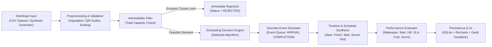

# System Architecture Specification

## 1. Architectural Overview

The **Resource Allocation and Scheduling Optimization System** is engineered as a decoupled, multi-tier enterprise simulation and optimization platform. It bridges high-throughput discrete-event simulation, combinatorial optimization metaheuristics, and reinforcement learning control with an interactive web analytics dashboard.

```mermaid
graph TD
    subgraph Client ["Frontend Client (React 18 + Vite + Tailwind CSS)"]
        UI_Dash["Dashboard & KPIs"]
        UI_Sim["Discrete-Event Simulation (Gantt)"]
        UI_Bench["Benchmark Comparison Matrix"]
        UI_Data["Dataset & 8-Step Preprocessing"]
        UI_Exp["Experiment History"]
        API_Client["Axios REST Client (services/api.js)"]
    end

    subgraph Server ["FastAPI Backend (Python 3.10)"]
        Router["API Gateway / Routers (app/api/routes.py)"]
        DB_ORM["SQLAlchemy ORM (SQLite: cluster_scheduler.db)"]
        
        subgraph Core_Engine ["Simulation & Scheduling Core"]
            Engine["SchedulingDecisionEngine (Unified Dispatcher)"]
            DES["DiscreteEventSimulator (Min-Heap Event Queue)"]
            RM["ClusterResourceState (Multi-Resource Tracker)"]
            Eval["PerformanceEvaluator (5-Metric Academic Formulations)"]
            Bench["BenchmarkRunner (Multi-Algorithm Comparator)"]
        end

        subgraph Algorithms ["Scheduling Algorithms (10 Implemented)"]
            subgraph Heuristics ["Classical Deterministic Heuristics"]
                FCFS["FCFS"]
                SJF["SJF"]
                PRIO["Priority"]
                EDF["EDF"]
                GREEDY["Greedy Best-Fit"]
            end
            subgraph Metaheuristics ["Stochastic Global Metaheuristics"]
                GA["Genetic Algorithm (Permutation Chromosomes)"]
                PSO["Particle Swarm Optimization (Continuous Mapping)"]
                SA["Simulated Annealing (Boltzmann Acceptance)"]
            end
            subgraph RL ["Reinforcement Learning Agents"]
                QL["Tabular Q-Learning (Bellman TD)"]
                DQN["Deep Q-Network (PyTorch MLP + Replay Buffer)"]
                RL_Env["ResourceSchedulingEnv (Gym-like Interface)"]
            end
        end
    end

    %% Client-Server Connections
    UI_Dash --> API_Client
    UI_Sim --> API_Client
    UI_Bench --> API_Client
    UI_Data --> API_Client
    UI_Exp --> API_Client
    API_Client <-->|REST / JSON (Port 8000)| Router

    %% Backend Routing
    Router --> DB_ORM
    Router --> Engine
    Router --> Eval
    Router --> Bench

    %% Core Dispatching
    Engine --> Heuristics
    Engine --> Metaheuristics
    Engine --> RL
    Heuristics --> DES
    Metaheuristics --> DES
    RL --> RL_Env
    RL_Env --> DES
    DES --> RM
```

---

## 2. Component Deconstruction & Data Flow

### 2.1 Workflow Pipeline Architecture



### 2.2 System Modules and Responsibilities

| Module Directory | Primary Class / Functions | Architectural Responsibility |
| :--- | :--- | :--- |
| `backend/app/workload/` | `Job`, `WorkloadLoader`, `WorkloadGenerator` | Encapsulates job model entities, loads Google cluster trace CSVs, generates synthetic contention scenarios (LIGHT, MEDIUM, HEAVY, BURSTY, OVERLOADED) using reproducible random seeds. |
| `backend/app/preprocessing/` | `PreprocessingPipeline` | Performs 8-step data preparation: missing value imputation (mean/median/mode), IQR outlier clipping, min-max scaling, and schema validation. |
| `backend/app/simulation/` | `DiscreteEventSimulator`, `ClusterResourceState` | Maintains simulation clock $t$, priority event queue, multi-resource active tracking (CPU cores, RAM MB, GPU units), timeline generation, and upfront feasibility checks. |
| `backend/app/scheduler/` | `SchedulingDecisionEngine` | Unified orchestrator for all 10 algorithms. Manages execution timing, standardizes schedule output dictionary, isolates rejected jobs, and formats timeline objects. |
| `backend/app/algorithms/` | `heuristics`, `metaheuristics`, `reinforcement_learning` | Houses algorithm implementations across classical, stochastic metaheuristic, and RL paradigms. |
| `backend/app/evaluation/` | `PerformanceEvaluator`, `BenchmarkRunner` | Computes standardized academic metrics (Makespan, Avg Wait, Utilization, SLA Violation Rate, Cost, Composite Efficiency Score). Executes multi-algorithm comparative suites. |
| `backend/app/database/` | `get_db`, `ExperimentRecord`, `DatasetRecord` | SQLite engine configured via SQLAlchemy ORM for experiment history logging and schema persistence. |
| `backend/app/api/` | `routes.py`, `app.main` | Exposes REST endpoints, performs Pydantic request validation, configures CORS origins, and handles error responses. |
| `frontend/src/pages/` | `Dashboard`, `Simulation`, `Results`, `Experiments`, `Documentation` | Responsive React 18 SPA built with Tailwind CSS, Recharts for comparative analytics, and customized Gantt timeline visualization. |

---

## 3. Technology Stack & Justification

| Layer | Selected Technology | Version | Technical Justification |
| :--- | :--- | :--- | :--- |
| **Backend Framework** | FastAPI (Python) | 0.110+ | High-performance asynchronous API framework with automatic OpenAPI documentation and strict Pydantic type validation. |
| **Simulation Runtime** | Python Standard Library (`heapq`) | 3.10 | Native discrete-event event-queue management utilizing $O(\log N)$ priority queue operations. |
| **Deep Learning** | PyTorch (`torch.nn`) | 2.1+ | Parameterizes Deep Q-Network with automatic differentiation, Adam optimizer, and GPU/CPU tensor abstractions. |
| **Scientific Computing** | NumPy & Pandas | 1.26+ | Vectorized multi-dimensional matrix operations for metric evaluations and cluster trace manipulation. |
| **Database & ORM** | SQLAlchemy + SQLite | 2.0+ | Serverless, zero-configuration embedded relational persistence ensuring reproducibility without external database service dependencies. |
| **Frontend Framework** | React + Vite | 18.2 / 5.4 | Ultra-fast Hot Module Replacement (HMR), optimized production tree-shaking, and declarative component state management. |
| **Visualization** | Recharts & Lucide Icons | 2.12+ | Composable SVG-based chart library providing high-density responsive bar, line, and radar visualizations. |
| **Styling** | Tailwind CSS | 3.4+ | Utility-first CSS framework enabling high-performance, responsive, clean enterprise UI layout design. |

---

## 4. Communication & Deployment Specifications

- **Client-to-Server Protocol**: HTTP/1.1 REST over JSON.
- **Port Allocation**:
  - Backend API: `http://127.0.0.1:8000`
  - Frontend SPA Preview / Dev: `http://127.0.0.1:3000` or `5173`
- **CORS Policies**: Explicitly allows local development hostnames (`localhost:3000`, `127.0.0.1:3000`, `localhost:5173`, `127.0.0.1:5173`) with full method support (`GET`, `POST`, `OPTIONS`).

