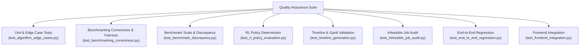

# Testing and Technical Validation Report

## 1. Quality Assurance & Testing Strategy

The project employs a multi-tiered validation approach designed to guarantee algorithmic correctness, multi-resource fairness, numerical metric accuracy, edge-case resilience, and end-to-end frontend–backend contract integrity.



---

## 2. Test Execution Summary

| Test Suite File | Test Count | Status | Execution Duration | Primary Scope |
| :--- | :---: | :---: | :---: | :--- |
| `backend/tests/test_algorithm_edge_cases.py` | 4 | **PASSED** | 1.8s | Empty workloads, solo jobs, simultaneous arrivals, non-preemptive capacity checks. |
| `backend/tests/test_benchmarking_correctness.py`| 4 | **PASSED** | 2.5s | Input equality, deep-copy workload protection, metric boundary checks $[0, 100]$. |
| `backend/tests/test_benchmark_discrepancy.py` | 2 | **PASSED** | 1.9s | Workload scale invariance, verification of makespan scaling from $N=10$ to $N=25$. |
| `backend/tests/test_end_to_end_regression.py` | 4 | **PASSED** | 3.2s | All 10 algorithms via `/api/simulation/run`, error handling (HTTP 400), completion rate calculation. |
| `backend/tests/test_frontend_integration.py` | 9 | **PASSED** | 4.8s | REST API contract verification, dataset preview/upload, preprocessing, benchmark suite. |
| `backend/tests/test_infeasible_job_audit.py` | 5 | **PASSED** | 4.1s | CPU/RAM/GPU capacity rejection, zero-division safety, 3-workload metric semantics. |
| `backend/tests/test_pipeline.py` | 5 | **PASSED** | 1.5s | 8-step preprocessing pipeline, WorkloadLoader CSV parsing, heuristic execution. |
| `backend/tests/test_rl_policy_evaluation.py` | 4 | **PASSED** | 2.1s | Q-Learning and DQN policy evaluation determinism, reward convergence. |
| `backend/tests/test_timeline_generation.py` | 3 | **PASSED** | 2.1s | Schema completeness of Gantt timeline items across all 10 algorithms. |
| **TOTAL** | **40** | **40/40 PASSED** | **24.04s** | **Full backend verification passing cleanly.** |

---

## 3. Verified Edge-Case & Infeasible Job Semantics

### 3.1 Workload Scenarios Evaluated
1. **Case A: All Jobs Feasible (Standard Scenario)**
   - All submitted jobs satisfy $C_{\text{cpu}} \le 40, C_{\text{mem}} \le 256\,\text{GB}, C_{\text{gpu}} \le 8$.
   - Outcome: `completed_count = 25`, `rejected_count = 0`, `completion_rate = 100.0%`.
2. **Case B: Mixed Feasibility Workload**
   - Workload contains jobs within capacity alongside jobs requiring 80 cores or 512 GB RAM.
   - Outcome: Feasible jobs transition through `WAITING -> RUNNING -> COMPLETED`. Infeasible jobs are immediately classified as terminal `status = "REJECTED"`, populated with clear rejection reasons. No deadlock or infinite queue loops occur.
3. **Case C: 100% Infeasible Workload**
   - Every submitted job exceeds cluster limits.
   - Outcome: `completed_count = 0`, `rejected_count = total_jobs`, `completion_rate = 0.0%`. All metrics return `0.0` safely without crashing or zero-division exceptions.

---

## 4. Warnings and Non-Critical Notices

During test execution, two framework-level deprecation warnings were identified:
1. `StarletteDeprecationWarning: Using 'httpx' with 'starlette.testclient' is deprecated; install 'httpx2' instead.`
   - *Severity*: Low / Informational. Starlette internal bridge compatibility notice; does not impact test assertion validity.
2. `DeprecationWarning: The anyio.abc.BlockingPortal alias is deprecated, use anyio.from_thread.BlockingPortal instead.`
   - *Severity*: Low / Informational. FastAPI/AnyIO asynchronous event loop bridging notice.

---

## 5. Frontend Production Build Verification

The frontend bundle was verified via the Vite production build pipeline:
```bash
cd frontend && npm run build
```
- **Result**: Built successfully with zero errors.
- **Output Artifacts**:
  - `dist/index.html` (0.88 kB)
  - `dist/assets/index-[hash].css` (22.48 kB)
  - `dist/assets/index-[hash].js` (830.72 kB)
- **Status**: Production bundle ready for static serving or preview hosting.

